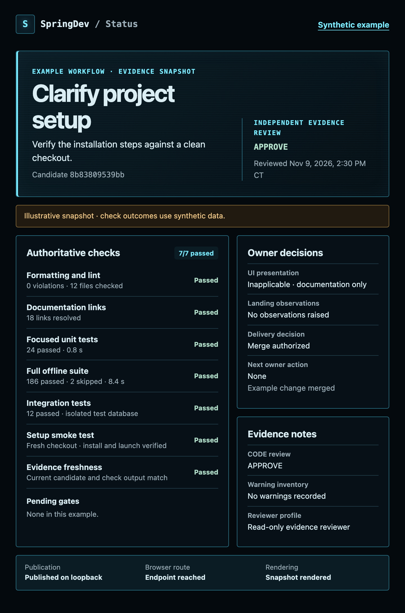

```text
██████  ██      ██████   █████  ██  ██  ██████   █████  ██  ██  ██████   █████  ██  ██
██      ██        ██    ██      ██  ██    ██    ██      ██  ██  ██      ██      ██ ██
██      ██        ██    ██      ██  ██    ██    ██      ██  ██  ██      ██      ████
█████   ██        ██    ██ ███  ██████    ██    ██      ██████  █████   ██      ███
██      ██        ██    ██  ██  ██  ██    ██    ██      ██  ██  ██      ██      ████
██      ██        ██    ██  ██  ██  ██    ██    ██      ██  ██  ██      ██      ██ ██
██      ██████  ██████   █████  ██  ██    ██     █████  ██  ██  ██████   █████  ██  ██


    01 PLAN
      02 IMPLEMENT
      03 CHEAP TESTS

    04 INTERACTIVE UI APPROVAL
      05 INDEPENDENT CODE REVIEW
      06 AUTHORITATIVE GATES
      07 SKEPTICAL EVIDENCE REVIEW
      08 FINAL VERDICT
      09 PR & MERGE
```

# FlightCheck



FlightCheck is a set of repository instructions and Codex configuration examples for taking a change from request to verified merge. It gives maintainers a repeatable way to run their own checks, review interactive HTML for UI changes, and see the evidence behind a landing decision.

### Get started

Use Git and a Codex client that discovers repository skills and supports separate [read-only reviewer sessions](examples/existing-project/docs/development-workflow.md#independent-review). Open your **existing project** in Codex, review the [example project layout](examples/existing-project/README.md), and merge the relevant files at the paths shown. Keep your project's instructions and permissions. Your project supplies the commands and runtimes for its checks, previews, CI, and delivery as applicable.

1. Merge the workflow entry into your `AGENTS.md`. Add the skill, workflow guide, and two reviewer role files.
2. Set the exact local checks, test isolation, preview method, evidence location, and delivery policy in the workflow guide. Use commands from your own stack and require the checks your repository actually uses.
3. Start a fresh Codex session in the target checkout. Verify the instructions, skill, and read-only reviewer setup on a small task. Ask Codex to use `$develop-change` for that task.

For receipt-backed checks and handoffs, use Python 3 on a POSIX host and copy [`scripts/capture_check.py`](examples/existing-project/scripts/capture_check.py), [`scripts/handoff.py`](examples/existing-project/scripts/handoff.py), and its adjacent module [`scripts/proof.py`](examples/existing-project/scripts/proof.py) into your project at those paths. All three files use the Python standard library. The recorder uses POSIX process controls and `fcntl` locking.

Set up the [task JSON](examples/existing-project/docs/development-workflow.md#resume-summary-and-final-packet), a [private evidence directory outside the checkout](examples/existing-project/docs/development-workflow.md#capture-native-check-output), and a [project-owned fingerprint command for each recorded gate](examples/existing-project/docs/development-workflow.md#reuse-a-result). If you enable coverage verification, use the documented [coverage report and frozen baseline format](examples/existing-project/docs/development-workflow.md#verify-native-test-coverage).

To have Codex adapt the configuration, give it access to the example files and use this prompt in your existing repository:

> Review the FlightCheck example project and my repository's current instructions, test commands, permissions, and delivery rules. Propose the smallest project-local diff. Adapt the workflow and reviewer files to my tools, preserve my existing policy, and verify the setup. Ask me to resolve any permission or delivery decisions that are missing.

<br clear="right">

### The workflow

1. Select a bounded task and agree on acceptance criteria. Work in a dedicated checkout and give each deterministic criterion a reproducible check.
2. Implement the change and run the cheap checks. For owner-facing UI, then show interactive HTML with synthetic data and pause for approval of that surface. Show renders only on request.
3. Apply the [early CODE review criteria](examples/existing-project/docs/development-workflow.md#decide-on-early-code-review) and record the reason for the decision. Then run the remaining required tests and visual checks within the project's permissions.
4. Give one independent final reviewer the current candidate, acceptance criteria, and verified gate evidence. Route the final verdict below.

| Verdict | Action |
| --- | --- |
| `APPROVE` | Begin landing under the recorded delivery grant after applicable gates pass. |
| `APPROVE_WITH_NITS` | Track the nits, then begin authorized landing. |
| `APPROVE_WITH_OBSERVATIONS` | Ask the owner to approve the specific observations before landing. |
| `REVISE` | Return to the plan or implementation and renew affected checks and reviews. |

Repair failures with the cheapest affected check first. Reuse a pass only when the command, coverage, inputs, environment, and original output still match. Run tests concurrently across worktrees when they have independently verified databases, ports, scratch space, and reports as applicable.

### Configuration and references

| Location | Use |
| --- | --- |
| [Example project layout](examples/existing-project/README.md) | Review the exact paths for instructions, skill, reviewer TOML, hooks JSON, rules, and optional Python test dependencies. |
| [Workflow guide](examples/existing-project/docs/development-workflow.md) | Adapt gate commands, evidence, review, and landing to your project. |
| [Status card guide](docs/status-card.md#view-the-example-card) | The optional card needs Python 3, permission to bind an available IPv4 loopback port, and a browser that can reach the listener. See [task card setup](docs/status-card.md#current-task) to publish your own task. |
| [GitHub CLI rule](examples/existing-project/README.md#verify-the-adoption) | For the optional issue-read rule, use an authenticated `gh`, adapt the repository in the rule, and check its exact command match. |
| [Claude Code pointer](examples/existing-project/README.md#adopt-flightcheck-in-an-existing-repository) | The optional [`CLAUDE.md`](examples/existing-project/CLAUDE.md) imports the shared project instructions into Claude Code. |
| [Benchmark guide](docs/benchmark.md) | Reproduce the pinned benchmark suite and find its results. |
| [Handoff reproduction](docs/benchmark.md#rehearse-a-handoff-with-synthetic-data) | Exercise the receipt and handoff workflow locally with synthetic data. |
| [Project board](https://github.com/orgs/spring-labs-inc/projects/2) | Track changes to FlightCheck. |

#### Run the FlightCheck tests

From the FlightCheck checkout, activate a Python 3 virtual environment on a POSIX host. Install pytest in that environment and run the suite.

```sh
python3 -m pip install pytest
python3 -B -m unittest discover -s tests
```

The recorder integration tests invoke pytest. The HTTP status-card tests need permission to bind an ephemeral port on `127.0.0.1`.
