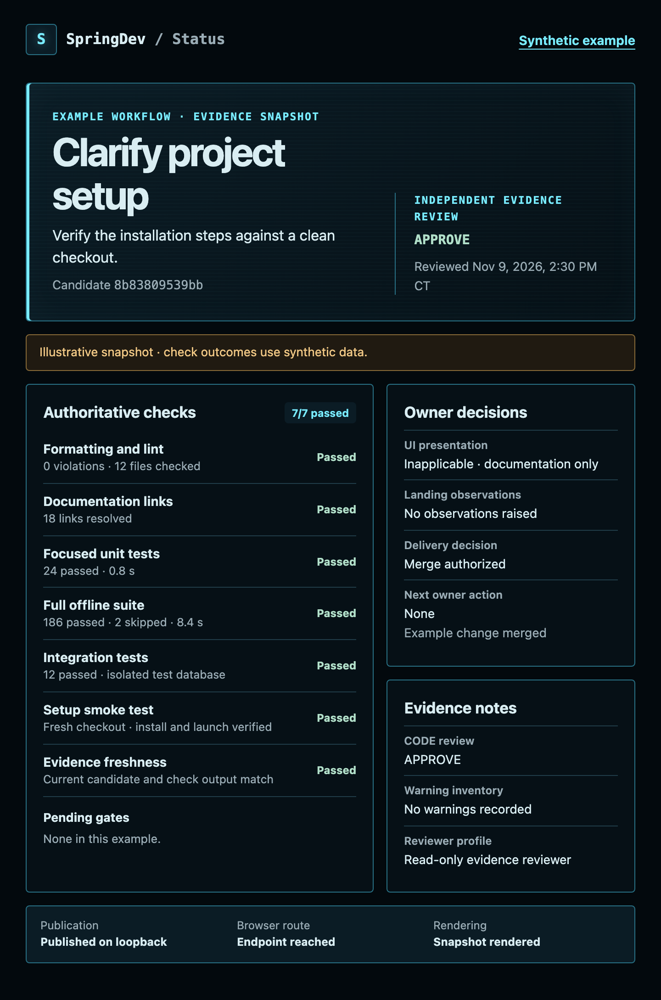

```text
██████  ██      ██████   █████  ██  ██  ██████   █████  ██  ██  ██████   █████  ██  ██
██      ██        ██    ██      ██  ██    ██    ██      ██  ██  ██      ██      ██ ██
██      ██        ██    ██      ██  ██    ██    ██      ██  ██  ██      ██      ████
█████   ██        ██    ██ ███  ██████    ██    ██      ██████  █████   ██      ███
██      ██        ██    ██  ██  ██  ██    ██    ██      ██  ██  ██      ██      ████
██      ██        ██    ██  ██  ██  ██    ██    ██      ██  ██  ██      ██      ██ ██
██      ██████  ██████   █████  ██  ██    ██     █████  ██  ██  ██████   █████  ██  ██


    01 PLAN
      02 IMPLEMENT
      03 CHEAP TESTS

    04 INTERACTIVE UI APPROVAL
      05 INDEPENDENT CODE REVIEW
      06 AUTHORITATIVE GATES
      07 SKEPTICAL EVIDENCE REVIEW
      08 FINAL VERDICT
      09 PR & MERGE
```

# FlightCheck



FlightCheck is a lightweight set of repository instructions that guides AI-assisted changes from request to landing.

- **See where the work stands.** A live status card shows the current stage, check results, verdict, and linked issues.
- **Follow a consistent workflow.** Each flight moves through planning, implementation, cheap checks, and UI approval when needed, followed by broader testing and skeptical review.
- **Make delivery decisions explicit.** The final verdict determines whether the change lands under the project’s delivery rules, returns for repair, or needs a user decision.
- **Carry evidence into every review.** Fingerprinted check results and original output pass between stages, helping reviewers catch defects and identify stale or incomplete evidence before approving a change.

<br clear="right">

## The workflow

- **01 PLAN:** select a bounded task, agree on acceptance criteria, and define reproducible checks in a dedicated checkout.
- **02 IMPLEMENT:** make the scoped change.
- **03 CHEAP TESTS:** run focused, inexpensive checks. Deterministic testing is always scripted and run by the agent, never delegated to the user.
- **04 INTERACTIVE UI APPROVAL:** for UI changes, obtain user approval using interactive HTML before broader testing.
- **05 INDEPENDENT CODE REVIEW:** run an early skeptical CODE review when the change’s risk or uncertainty warrants it, helping catch defects before broader testing.
- **06 AUTHORITATIVE GATES:** run the remaining required project checks, including applicable regression, integration, and visual checks.
- **07 SKEPTICAL EVIDENCE REVIEW:** independently review the current change, acceptance criteria, and verified evidence. Every flight receives this final code and evidence review.
- **08 FINAL VERDICT:** use the review findings to determine whether the change is ready to land, needs repair, or requires a user decision.
- **09 PR & MERGE:** create or update the pull request and merge under the project’s delivery rules after the required checks and approvals pass.

| Verdict | Action |
| --- | --- |
| `APPROVE` | Begin landing under the recorded delivery grant after applicable gates pass. |
| `APPROVE_WITH_NITS` | Track the nits, then begin authorized landing. |
| `APPROVE_WITH_OBSERVATIONS` | Ask the owner to approve the specific observations before landing. |
| `REVISE` | Return to the plan or implementation and renew affected checks and reviews. |

Handoffs carry check receipts and original output between stages. Fingerprints tie each result to the code, command, coverage, and environment that produced it. Before review or reuse, FlightCheck verifies those records and identifies missing, changed, or failed evidence. Repairs renew the affected checks and reviews while preserving earlier results for inspection.

## Get started

**Supported environments:** Claude Desktop, Claude Code TUI, Codex Desktop, and Codex TUI.

1. **Install FlightCheck.** Use pip (recommended):

   ```sh
   pip install flightcheck
   ```

   Or Homebrew (macOS Apple silicon):

   ```sh
   brew install spring-labs-inc/tap/flightcheck
   ```

2. **Configure your project or worktree.**

   ```sh
   cd /path/to/your/project
   flightcheck init . --agent claude
   flightcheck doctor .
   ```

   Setup confirms your project choices, previews changes, and asks before applying them, preserving existing instructions, permissions, dependencies, and delivery policy.

   Use `--agent codex` or `--agent both` for those clients.

3. **Start your first flight.** Open a fresh client session in the configured project. Use your client’s command below and request a small first flight. Open the printed status-card URL in your browser.

**Available skills**

```text
Claude: /develop-change
Codex:  $develop-change
```

The [Setup guide](https://github.com/spring-labs-inc/FlightCheck/blob/main/setup/README.md) covers installation prerequisites, additional options, and configuration limits.

## Guides

| Guide | Use |
| --- | --- |
| [Status Card](https://github.com/spring-labs-inc/FlightCheck/blob/main/docs/status-card.md) | Publish and view task progress and the current verdict. |
| [Workflow](https://github.com/spring-labs-inc/FlightCheck/blob/main/workflow/docs/development-workflow.md) | Follow the stages, delivery rules, and [skills and reviewers](https://github.com/spring-labs-inc/FlightCheck/blob/main/docs/skills-and-reviewers.md). |
| [Verdict](https://github.com/spring-labs-inc/FlightCheck/blob/main/workflow/docs/development-workflow.md#landing) | Understand verdicts and the rules for landing a change or returning for repair. |
| [Setup](https://github.com/spring-labs-inc/FlightCheck/blob/main/setup/README.md) | Configure Codex CLI, Codex Desktop, Claude Desktop, or Claude Code and verify the installation. |
| [Benchmarks](https://github.com/spring-labs-inc/FlightCheck/blob/main/docs/benchmark.md) | Read results and reproduce the pinned trials. |
| [Contributing](https://github.com/spring-labs-inc/FlightCheck/blob/main/CONTRIBUTING.md) | Read the contribution policy and run FlightCheck's own tests. |

## License and commercial use

FlightCheck is available under the [Functional Source License 1.1, with MIT as its future license (FSL-1.1-MIT)](https://github.com/spring-labs-inc/FlightCheck/blob/main/LICENSE). Personal and internal organizational use—including commercial work—is free. No account, subscription, or license key is required. Competing commercial offerings require separate permission during the applicable two-year period. Each version becomes available under MIT two years after publication. For additional permissions, contact [jeff@springfinance.io](mailto:jeff@springfinance.io). Subscriptions remain deferred.

Before copying workflow files, read the [licensing and adoption guide](https://github.com/spring-labs-inc/FlightCheck/blob/main/docs/licensing.md). Outside code contributions are currently deferred; [bug reports and feature requests are welcome](https://github.com/spring-labs-inc/FlightCheck/blob/main/CONTRIBUTING.md).
